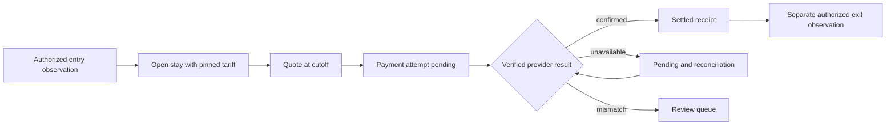
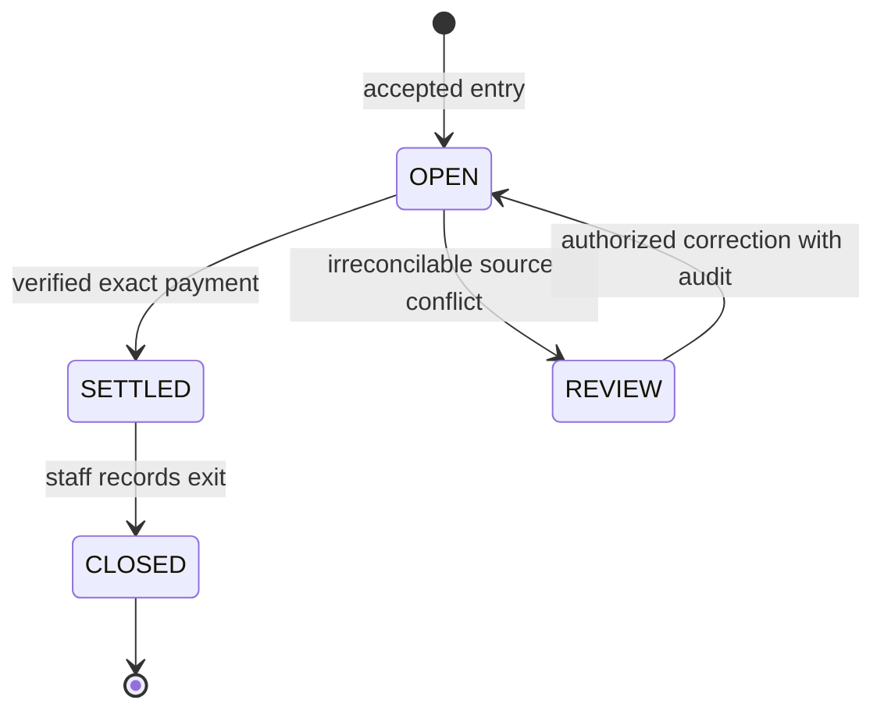

# A2 — Turn the workflow into rules that can be disproved

**Assignment:** Domain Model and Testable Specification. **Handoff:** rule IDs, data ownership and independent oracles. Read [A2 requirements](../sources/ISE-A2_Domain_Model_and_Testable_Specification_English.md).

## 1. Vocabulary and boundaries

A **vehicle token** identifies a synthetic vehicle within a lot; it is not a user identity. A **stay** is a recorded parking episode. A **tariff version** is immutable pricing policy. A **quote** is a fee snapshot through a specified cutoff and expiry. A **payment attempt** requests settlement of that exact quote. A **provider event** reports payment status and may be delivered repeatedly. A **receipt** represents confirmed settlement, while **exit** is a separate observation.

The source calls both identity and license plate `vehicle_id`. Use `vehicle_token` in fixtures and a separate internal `stay_id`. In a field system, define normalization and collision handling with the operator; do not assume OCR text reliably identifies a unique person or vehicle.

## 2. Process and state models





Payment states are separate: `PENDING → SUCCEEDED` or `PENDING → FAILED`; an unknown outcome remains `PENDING` and raises a review flag. A trusted late success after a local failure must enter reconciliation, not disappear. A succeeded payment is never downgraded by an older failure event. Quotes do not themselves change a stay to SETTLED; an OPEN stay may have multiple quote versions, but only one live payment attempt at a time. A zero-fee quote uses an authorized attendant-only, audited zero-fee settlement with no provider order; the server must revalidate that the stored quote amount is exactly zero. A pending attempt must be authoritatively resolved/cancelled before replacing it.

## 3. Data dictionary and responsibility

| Entity | Required fields / types | Authority and constraints |
| --- | --- | --- |
| Lot | id UUID, merchant_ref text, timezone text | Operator configuration; not request-supplied merchant |
| Stay | id UUID, lot_id FK, vehicle_token text, entered_at UTC timestamp, exited_at nullable timestamp, state enum, tariff_id FK, lock_version integer | Attendant records observations; one non-CLOSED stay per lot/token enforced by partial unique index |
| TariffVersion | id UUID, rate_fen integer ≥0, peak_numerator integer, peak_denominator integer >0, policy_ref text | Operator-approved immutable version; never overwrite a tariff used by a stay |
| Quote | id UUID, stay_id FK, cutoff_at timestamp, duration_seconds integer ≥0, billed_hours integer, amount_fen integer ≥0, currency text, tariff_id FK, expires_at timestamp, version integer | Server calculates and stores snapshot; amount/currency ignored if supplied by client |
| PaymentAttempt | id UUID, quote_id FK, merchant_ref text, provider_order_id unique, status enum, provider_txn_id unique nullable, version integer | Service initiates; adapter verifies provider result; one successful settlement per stay |
| ProviderEvent | provider_event_id unique text, received_at timestamp, body_digest text, verification_outcome enum | Server records deduplication and audit, not raw credentials |
| IdempotencyRecord | lot/principal/operation/key compound unique, request_digest, result_ref | Atomically saved with mutation; same key + changed payload is a conflict |
| AuditEvent | id UUID, actor_ref, operation, entity_ref, occurred_at, outcome, correlation_id | Append-only service record; minimized data |

Use foreign keys and database constraints as well as readable domain checks. A retention proposal for the sandbox is 30 days for synthetic task logs, then deletion; real payment/identity retention is a separate operator/data-steward decision. Account deletion may require pseudonymization rather than deletion of required financial records; do not invent a universal legal period. Restrict exports, cover backups, and test deletion/anonymization on synthetic records. No real plates or images enter this teaching repository.

## 4. Material fee rule and independent examples

Adopt H02–H04 in [SCENARIO.md](../SCENARIO.md) only as a classroom contract. For integer seconds `s ≥ 0`, `hours = (s + 3599) / 3600` with integer division. Compute `hours × rate_fen × coefficient` exactly as a rational number, then round once to the nearest fen, half-up. Reject negative duration, missing/timezone-free timestamps, and unsupported money inputs. Store/display UTC instants in the lot's timezone; never subtract unqualified local strings.

| Seconds | Rate fen/hour | Coefficient | Expected hours | Expected fen |
| ---: | ---: | ---: | ---: | ---: |
| 0 | 1000 | 1 | 0 | 0 |
| 1 | 1000 | 1 | 1 | 1000 |
| 3600 | 1000 | 1 | 1 | 1000 |
| 3601 | 1000 | 1 | 2 | 2000 |
| 3600 | 1000 | 3/2 | 1 | 1500 |
| 1 | 1 | 3/2 | 1 | 2 |
| -1 | 1000 | 1 | rejected | rejected |

These expected values are manually derived oracle fixtures, not the calculator's output recycled into a test. Reproduce them with [the seed](../reference/lib/fee_calculator.rb), then invent another boundary independently. `ABC123, one billed hour, 10.0` from the image is compatible with this chosen tariff; it does not establish the tariff for a real operator.

## 5. Invariants and violating examples

| Rule | Invariant | Counterexample / independent check |
| --- | --- | --- |
| BR01 | At most one non-CLOSED stay per lot/token | Two simultaneous entry transactions; DB uniqueness must leave exactly one stay |
| BR02 | Quote cutoff ≥ entry; final exit ≥ entry | Earlier clock or missing entry; reject without charge |
| BR03 | Quote amount derives from pinned tariff and exact rounding | Change “current rate” after entry; old stay keeps old policy |
| BR04 | Nonzero settlement requires verified provider identity, merchant, order, currency and exact amount | Browser `paid=true`, wrong merchant, or one-fen mismatch cannot settle |
| BR05 | Same authorized request key/payload has one effect | Retry after lost response; same receipt, no second charge; changed payload conflicts |
| BR06 | Server authorizes principal, lot and object on every path | Driver B reads or pays Driver A's stay; no data or mutation leaks |
| BR07 | Confirmed payment is monotone and audited | A late failed event arrives after success; success must not be reversed |
| BR08 | Stale version cannot overwrite newer state | Two staff updates share an old version; exactly one succeeds |

Only the arithmetic portion of BR02/BR03 is implemented by the supplied seed. BR01 and BR04–BR08 require the A4 application and database tests. Keep these statuses visible in [traceability](../TRACEABILITY.md).

For H05, an attempt may start when server `now ≤ expires_at`. Verify the provider's authenticated payment time, not callback arrival time: a timely payment with delayed delivery can settle its locked attempt; a truly late payment enters manual reconciliation/refund handling without automatic release. Freeze this policy before implementing callbacks.

## 6. Copyable Codex task

```text
Read the A1 accepted brief, SCENARIO.md, chapters/A2-domain.md and the task contract.
Using only approved assumptions, produce glossary, context map, event flow, state
models, dictionary, invariant table and a model-walkthrough checklist under docs/domain.
Implement only the pure fee rule and its input checks first. Use integer fen and
rational coefficients. Add independent boundary fixtures; do not compute expected
values with the implementation under test. List which invariants remain unimplemented.
Do not create payment credentials, connect cameras or infer operator policy.
Acceptance: at least three invariants have violating examples; one monetary rule has
an executable independent oracle; missing source, ownership and retention decisions
are explicit. Run allowed local checks and retain their real output and exit status.
```

## 7. Walkthrough and explain-back

Have one student act as driver, one as attendant, and one as payment provider. Walk through duplicate entry, changed tariff, lost callback, and wrong tenant. Record model changes and dissent; do not label a hypothetical role-play “representative-user validation.” Explain why “payment failed” and “payment outcome unknown” require different next actions. Transfer: introduce a 15-minute grace period and state whether it is subtracted or merely exempts short stays; predict new boundary tests before coding. Deliver the original A2 artifacts and hand the frozen rules to A3.
