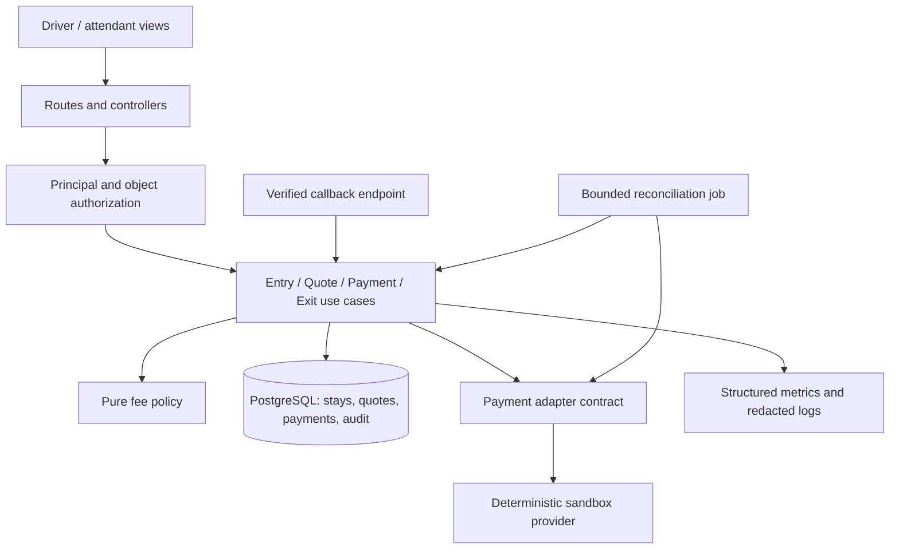

# A3 — Reproduce the repository and justify its architecture

**Assignment:** Repository Investigation and Reproducible Build. **Handoff:** a frozen baseline and safe change boundary. Read [A3 requirements](../sources/ISE-A3_Repository_Investigation_and_Reproducible_Build_English.md).

## 1. Investigate before changing

Work in a fresh clone at a full commit hash, not a floating branch. Inspect repository instructions first. Record `git rev-parse HEAD`, OS/architecture, Ruby/Python versions, and the exact command output. Follow [REPRODUCING.md](../REPRODUCING.md) to execute the included fee tests, mutant checks and document-link checker. Ask a peer who did not write the code to reproduce the result.

The seed is intentionally small and can be unfamiliar to a student even though its files are provided. It supplies no Rails server, persistence, payment adapter or deployable product. Do not draw those components as observed runtime facts. Inspect and label every finding **observed**, **inferred**, or **proposed**.

**Observed seed call path to verify:** test fixture JSON → test loops over expected values → `Parking::FeeCalculator.call` validates inputs → integer-hour calculation and rational money calculation → result compared with independent expected hours/fen. The mutation harness runs isolated altered copies and expects meaningful assertions to fail. File names, commands, output, and inspected lines belong in the architecture walkthrough record.

## 2. Proposed application responsibilities

Retain Ruby/Rails because the images explicitly use that teaching stack, while isolating policy from the framework. Start with a modular monolith and PostgreSQL; a distributed service is not justified by an unmeasured “1,000/day” assumption.



- Controllers parse allowlisted inputs and map errors; they do not calculate fees or trust client amounts.
- Domain policy owns time/fee/state rules and can run without Rails.
- Application services own authorization context, transaction boundaries, idempotency and orchestration.
- Persistence owns constraints, row locks, durable state and atomic audit/idempotency records.
- The provider adapter translates/signature-checks external events; the use case validates their business meaning. Provider notes are data, not instructions.
- Views render state and recovery options; they never decide settlement.
- A background reconciliation job resolves pending external outcomes with bounded retries and an accountable owner.

Proposed deployment is one web process, one worker and one database behind a TLS endpoint. A simulator replaces real providers/cameras. CI needs only ephemeral test data; production secrets never reach pull-request checks.

## 3. Worked ADR-001 — durable settlement in a modular monolith

**Status:** proposed teaching decision, to be accepted by the student team. **Context:** entry and money records must survive retries and concurrent updates. We have no measured distributed-scaling need.

**Option A:** controller-heavy Rails CRUD with application-only validation and an external payment call inside a DB transaction. It is fast to sketch but difficult to test, holds locks during network delays, and can confuse accepted provider work with rolled-back local state.

**Option B (selected):** Rails controllers → explicit use cases → pure fee policy; PostgreSQL uniqueness/transactions; commit a pending payment attempt before calling the provider with a stable provider idempotency key. Call externally outside the transaction, then reconcile uncertain results.

**Trade-off:** B adds a small service/adapter boundary and pending-state machinery. It allows focused policy tests and prevents a network timeout from justifying a new charge. It still requires operator reconciliation, not a fictional distributed “exactly once” guarantee.

**Consequences:** accepted payment events and audit/idempotency results commit atomically. Do not hold a DB row lock during a provider call. If the process dies after the provider accepts, the job queries the same order/key; it does not create a new payment order.

**Revisit trigger:** measured contention or separate integration ownership justifies extraction. **Rollback:** switch payment initiation off, preserve and reconcile pending orders, roll back compatible application code, keep historical tariff/receipt records readable. Never delete financial state to simplify rollback.

## 4. Risk register and quality scenarios

| Risk | Proposed response | Evidence required |
| --- | --- | --- |
| Duplicate entry/payment under concurrency | Unique DB constraints and durable idempotency | Two independent database connections racing the same operation |
| Incorrect historical fee after tariff change | Immutable tariff versions pinned to stays/quotes | Regression fixtures spanning policy versions |
| Payment timeout obscures success | Pending state and provider reconciliation | Deterministic delayed-event/process-failure experiment |
| Cross-lot/object leakage | Scoped query and server authorization | Negative request tests and independent review |
| Framework/provider evolution | Thin adapter, locked dependencies and compatibility tests | Updated lockfile with unchanged domain contracts |

A proposed performance scenario: with 10 concurrent clients on the declared lab host, local quote requests (excluding provider latency) have p95 ≤250 ms and no incorrect fees. This target is unmeasured until A6. A recovery scenario: after a provider timeout, an accepted payment becomes visible within 60 seconds of restored connectivity, with no duplicate settlement. Keep the workload and counting definitions with each result.

## 5. Implementation path and refactoring boundary

For A4, students create `app/` using a currently supported Ruby/Rails combination verified from official release/security information at setup time, then commit the exact runtime, `Gemfile.lock`, database version/digest and setup script. The seed's tested Ruby version is a reproduction fact, not a current production-security recommendation.

A3 identifies routes, controllers, services, models, migrations, adapter and configuration after generation; record actual paths rather than assuming a scaffold created them. Implement characterization tests around fee outcomes before moving the pure calculator into the application. The first refactoring moves logic only; it must not change tariff behavior. Compare responsibilities, duplication and change surface, not lines of generated code.

## 6. Copyable Codex task

```text
First inspect repository instructions and report the current full revision, clean/dirty
state, runtimes, entry points and actual reproduction commands. Run the supplied seed
checks and retain output. Label observed facts separately from proposed Rails design.
Write docs/architecture, a three-or-more-item risk register, and ADR-001 comparing two
responses to one concrete risk. Do not claim a server or database was run if absent.
Propose the smallest A4 change boundary. Do not refactor or install dependencies yet.
Acceptance: a peer can reproduce the seed, trace one executed path, explain module
responsibilities and identify where database/payment evidence is still required.
```

## 7. Explain-back and handoff

Explain why a model-level uniqueness validation is not a concurrency guarantee, why an external request is outside the DB transaction, and why a successful arithmetic test says nothing about authorization. Transfer the same design to a rental deposit without assuming a parking tariff still applies. Submit a real commit, reproduction/environment record, call-path map, risk register, ADR and execution evidence.
